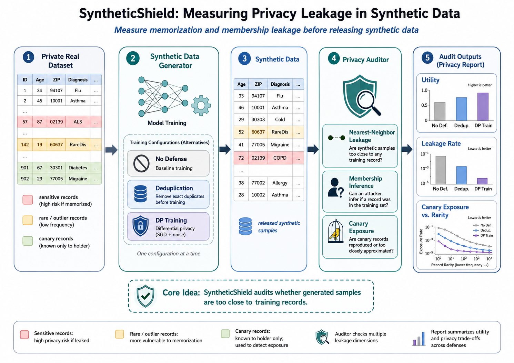

# SyntheticShield: Measuring Privacy Leakage in Synthetic Data



SyntheticShield is a lightweight research repository for auditing privacy leakage in synthetic data generators. It creates a private tabular dataset, inserts rare canary records, trains multiple synthetic-data generators, and measures whether generated samples are too close to private training records.

The repo is designed to produce a complete mini-paper experiment with one command:

- **Main figure:** private dataset → generator → synthetic data → privacy auditor.
- **Panel A:** utility of synthetic data.
- **Panel B:** membership leakage rate.
- **Panel C:** canary exposure versus rarity.

## Repository layout

```text
SyntheticShield/
├── README.md
├── requirements.txt
├── pyproject.toml
├── configs/
│   └── default.json
├── syntheticshield/
│   ├── __init__.py
│   ├── auditor.py
│   ├── data.py
│   ├── generators.py
│   ├── metrics.py
│   └── plotting.py
├── scripts/
│   ├── run_experiment.py
│   └── make_figures.py
├── tests/
│   └── test_smoke.py
├── paper/
│   ├── main.tex
│   └── references.bib
└── outputs/              # generated by scripts
```

## Setup

```bash
python -m venv .venv
source .venv/bin/activate
pip install -r requirements.txt
```

## Run the full experiment

```bash
python scripts/run_experiment.py --config configs/default.json --out outputs
python scripts/make_figures.py --results outputs/metrics_summary.csv --canaries outputs/canary_exposure.csv --out outputs/figures
```

The generated files include:

```text
outputs/metrics_summary.csv
outputs/canary_exposure.csv
outputs/threshold_sweep.csv
outputs/synthetic_preview_no_defense.csv
outputs/synthetic_preview_dp_training.csv
outputs/synthetic_preview_deduplication.csv
outputs/figures/main.png
outputs/figures/figure2.png
outputs/figures/figure3.png
outputs/figures/figure4.png
```

## Method overview

SyntheticShield uses three generator settings:

1. **No defense:** a memorizing nearest-neighbor bootstrap generator that perturbs sampled private rows with small noise.
2. **DP training:** a clipped Gaussian generator with simple DP-inspired parameter noise.
3. **Deduplication:** a pre-processing defense that removes duplicate and high-outlier rows before fitting a bootstrap generator with stronger perturbation.

The auditor reports:

- **TSTR utility AUC:** train a downstream classifier on synthetic data, test on held-out real data.
- **Membership inference AUC:** use nearest-neighbor distance to synthetic records as the attack score.
- **Leakage rate @ 5% FPR:** true-positive rate of the membership attack when false positives on non-members are capped at 5%.
- **Canary exposure:** nearest-neighbor closeness of inserted canaries in generated data, grouped by rarity.

## Paper compilation

After generating the figures, compile the paper from the `paper/` folder:

```bash
cd paper
pdflatex main.tex
bibtex main
pdflatex main.tex
pdflatex main.tex
```

The LaTeX file expects figures at `../outputs/figures/`.

## Notes

This is a compact, reproducible research prototype. The DP setting is intentionally labeled **DP-inspired** rather than a formal privacy guarantee. To make formal differential privacy claims, replace the generator with a certified DP training algorithm and track the privacy accountant.

## Citation

If you use this repo, cite it as:

```bibtex
@misc{syntheticshield2026,
  title = {SyntheticShield: Auditing Memorization and Membership Leakage in Synthetic Data Generators},
  author = {Mahajan, Tejas},
  year = {2026},
  note = {Research prototype}
}
```
